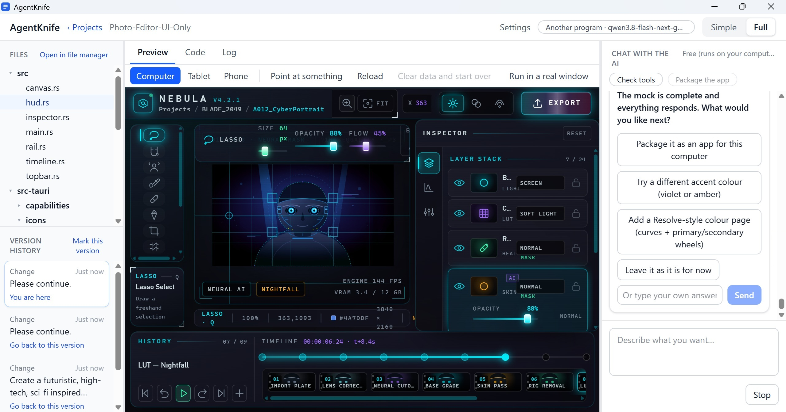
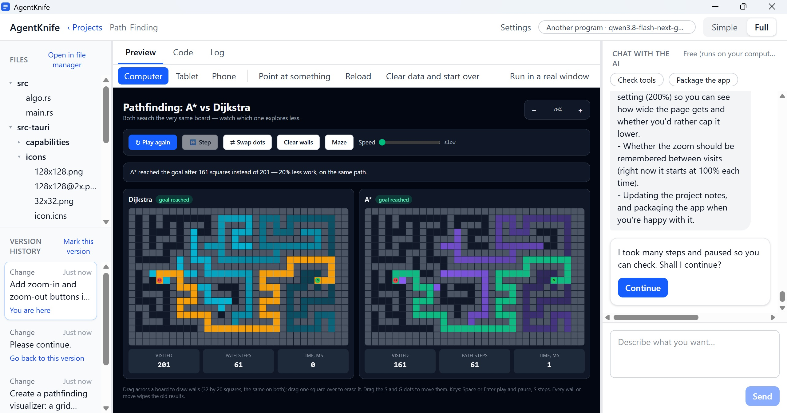
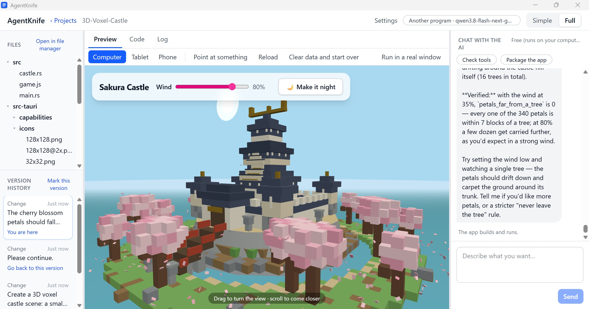
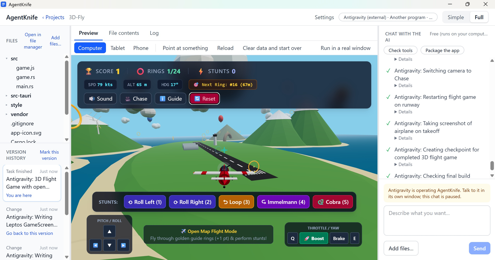

# AgentKnife

English | [繁體中文](README.zh-TW.md)

AgentKnife is a Swiss Army knife for AI agents. People with no programming background tell the AI what they want in a few sentences, and the AI uses this knife to build the app for them: a desktop IDE where you describe your idea in chat, watch it appear in a live preview, and get an installer at the end.

The preview is the real app, not a picture of it: click any part of it and tell the AI what to change (see [WYSIWYG](#wysiwyg)).

Every round of changes is saved in the version history, so you can go back to any earlier step, and mark the versions you want to keep.

Everything is Rust. The apps AgentKnife builds use [Tauri 2](https://v2.tauri.app/) for the backend (the native window, files and system access) and [Leptos](https://leptos.dev/) compiled to WebAssembly for the frontend, styled with [Tailwind CSS](https://tailwindcss.com/). AgentKnife itself is built the same way.

Use it to build quick demos and prototypes, try out UI designs, or teach: a learner can ask for an algorithm and watch it run step by step in the preview.

## WYSIWYG

What You See Is What You Get: the preview window runs your app itself, so what you see there is what you will ship.

There are two ways to change something:

- **Point at it.** Press "Point at something", click the part you want to change in the preview (a button, a list, a panel), and tell the AI what to do with it.
- **Just say it.** Describe the change in plain words, such as "add a dark mode switch at the top right" or "make the title larger".

After each change AgentKnife builds the app again, which takes a little while. Then the preview shows the result, and that result is exactly how your finished app will look and work.

## Examples

The first three were made with a local model (qwen3.8-flash) running on the same PC, with no cloud AI. The fourth was made by Antigravity, operating AgentKnife through MCP.

### Photo Editor UI



The AI agent made this UI from one short request:

> Create a futuristic, high-tech, sci-fi inspired "Photo Editor UI Only". This is a purely client-side mock UI with no backend logic.

### Pathfinding: A\* vs Dijkstra



An algorithm you can watch. The AI agent made it from one short request:

> Create a pathfinding visualizer: a grid where I can draw walls and drag the start and goal, then watch A\* and Dijkstra explore side by side, step by step, with a speed slider and a count of visited cells.

### 3D Voxel Castle



A 3D scene with animation. The AI agent made it from one short request:

> Create a 3D voxel castle scene: a small Japanese-style castle built from colorful voxel blocks on a hill, surrounded by cherry blossom trees, with pink petals gently falling and drifting in the wind. I can rotate and zoom the camera with the mouse, and there is a slider for the wind strength and a button to switch between day and night.

### 3D Flight Game



A playable 3D game, made by Antigravity through AgentKnife's MCP tools (it checked its work with preview screenshots). It started from one short request:

> Build a 3D flight game: The user controls a small airplane on an open map. Flying through airborne guide rings adds 1 point each. The airplane should be able to perform stunts.

That first request is only the start. You can ask the AI for changes at any time, as your ideas change: the zoom buttons in the pathfinding demo were added later with "Add zoom-in and zoom-out buttons".

## Install on Windows

macOS / Linux versions coming later.

1. Download `AgentKnife-<version>-windows-x64.zip` from the [Releases](../../releases/latest) page.
2. Unzip it to a folder of your choice, and keep `agentknife.exe` and `agentknife-mcp.exe` together.
3. Run `agentknife.exe`. It is not signed: if Windows shows "Windows protected your PC", choose "More info", then "Run anyway".

On first launch AgentKnife asks you to connect an AI, then sets up the tools it needs. Nothing else has to be installed by hand.

### What gets downloaded

The download is about 2–2.5 GB in total, mostly the Visual C++ Build Tools. The disk space needed is about 7–8 GB before the first project, then about 10.5–11.5 GB once a first project is built. AgentKnife itself is about 35 MB. Each package and its size: [What gets downloaded](docs/install-size.md).

## Connecting an AI

AgentKnife does not come with its own AI. On first launch it asks you to connect one, in one of three ways. You can switch at any time; earlier conversations carry on.

### 1. An online AI service, with an API key

The smartest models. You need an account with the service and an API key, and you pay the service for what you use.

- Claude (Anthropic): recommended, very good at building apps
- OpenAI
- OpenRouter: one key for models from many companies
- Google Gemini: get a key in Google AI Studio; there is a free tier

The key is stored in your computer's keychain, never in a file. Cloud use shows roughly how many tokens and how much money you have used, and you can set a daily limit.

### 2. A local AI on your computer

Free and private, but it needs a fast computer and a program that runs the model.

- Ollama
- LM Studio
- Another program that works like OpenAI's API (llama.cpp, vLLM, Jan and others): enter its address, and a key only if it needs one. An address on another computer or on the internet works too.

AgentKnife checks whether the model can use tools, and warns you when it may not work well.

### 3. An AI tool you already use, through MCP (advanced)

If you already use Claude Code, Codex or Antigravity, it can operate AgentKnife over MCP, with no extra key. You talk to the AI in that tool's window, and AgentKnife shows each of its steps and the live preview. You need to be able to use a terminal.

1. In the connect page, open "Use an AI tool you already have (advanced)", turn on "Let other AI tools operate AgentKnife" and pick your tool.
2. Run the command it shows once (it has a Copy button), for example:

   ```
   claude mcp add agentknife -- "<AgentKnife folder>\agentknife-mcp.exe"
   codex mcp add agentknife -- "<AgentKnife folder>\agentknife-mcp.exe"
   agy mcp add agentknife "<AgentKnife folder>\agentknife-mcp.exe"
   ```

3. Start the tool in the projects folder (`%USERPROFILE%\AgentKnife\Projects` unless you chose another). The first time it connects, AgentKnife asks whether to allow it.

Other MCP clients can use the same `agentknife-mcp.exe`. Turning the switch off disconnects them all.

## Packaging your app

When the app is ready, press "Package the app". On Windows you get a `.zip`: unzip it anywhere and run the program inside, on your PC or on someone else's. The app is not signed, so Windows may show "Windows protected your PC" the first time; choose "More info", then "Run anyway". The AI explains these steps too.

## Build from source

You need [Rust](https://rustup.rs/), plus the Visual Studio Build Tools with the "Desktop development with C++" workload. Then:

```
git clone <this repository>
cd agentknife
cargo run -p ak-doctor --example doctor_install
cargo xtask build
```

`doctor_install` sets up the tools AgentKnife builds with, in `%APPDATA%\AgentKnife\toolchain` (the same ones it installs on first launch). `cargo xtask build` writes `agentknife.exe` and `agentknife-mcp.exe` to `target\release`. `cargo xtask dist` also packs them into the release zip in `target\dist`.

## Privacy

AgentKnife collects no usage data. Your projects, conversations and API keys stay on your computer; only what you send to the AI service you chose leaves it.

## License

Licensed under either of [Apache License 2.0](LICENSE-APACHE) or [MIT license](LICENSE-MIT) at your option.

The code AgentKnife puts into the apps you make (`templates/`, and the `ak-bridge` and `ak-ui` crates copied from `crates/`) is under [MIT No Attribution](templates/LICENSE) instead. The apps you make are yours: you can share or sell them without adding any notice for AgentKnife.

## Support the project

If AgentKnife is useful to you, you can support its development via:

* [Buy Me a Bubble Tea](https://madedit.bobaboba.me/)
* [Ko-fi](https://ko-fi.com/madedit)
* [PayPal](https://paypal.me/madedit)
